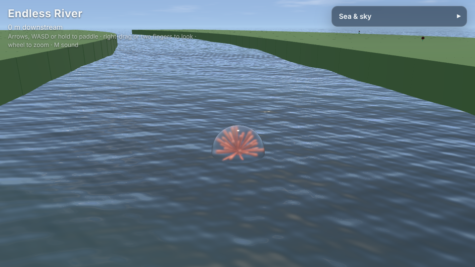
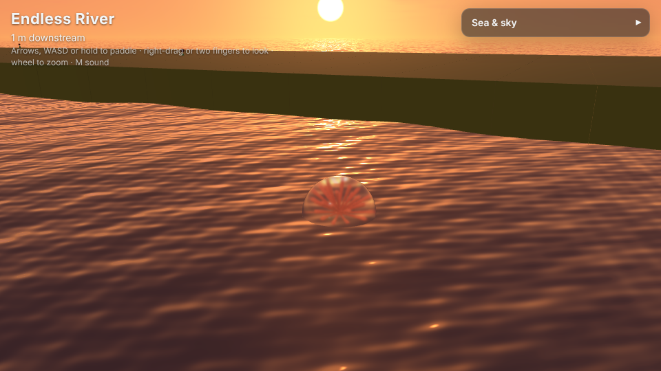
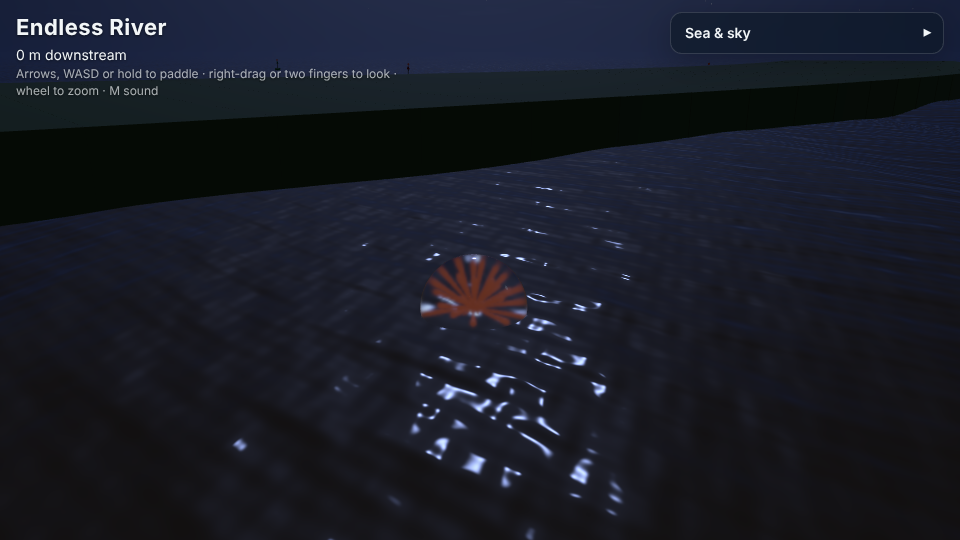
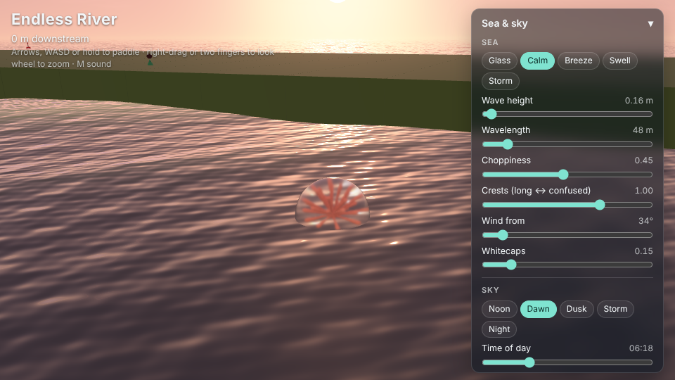

# Endless River




| | |
|---|---|
|  |  |
|  | |

A glass float adrift on a sea that never ends. Paddle it about, ride the
swell, bounce off the buoys, and turn the sea and the sky with the sliders,
from flat calm at dawn to a storm with crests twenty metres from trough to
top. Nothing is painted: the water, the sky and the light are worked out as
they are drawn, so it never repeats.

It is built on [madness-engine](https://github.com/h1ddenpr0cess20/madness-engine):
the stage, the controls, the splashes, the sound and the glass float (the
engine's marble, blown up) are the engine's, and so is the sea itself,
`madness-engine/ocean`, which any game on the engine can use.


| | |
| Dawn | Night |
| A long swell at dusk | The sliders |

## Run

```sh
npm install
npm run dev      # http://localhost:5173
npm run build    # static build in dist/
```

Needs WebGPU or WebGL 2 (any current browser); `?renderer=webgl` or
`?renderer=webgpu` pins one. `?sea=storm&sky=dusk` starts in any of the
presets (seas: glass, calm, breeze, swell, storm; skies: dawn, noon, dusk,
storm, night), and `?panel=closed` with the panel folded away.

## Controls

- Arrows or WASD, or hold anywhere: paddle
- Right-drag, Q/E, or two fingers: look round; wheel, +/− or pinch: zoom
- C: the view back home; M: sound

## The sliders

- **Sea**: the presets, then wave height, wavelength, choppiness (how
  sharp the crests are), crests (long and lined up, or confused), where
  the wind blows from, and whitecaps. Each change rolls into the sea
  smoothly rather than jumping.
- **Sky**: the presets, then the time of day (the sun, or the moon, goes
  over), overcast, clouds, haze and exposure, and *Let the day go by*: a
  day in four minutes.
- **View**: how far back the camera is. It also rises on its own to see
  the float over any crest in the way.

## How the sea works

All of this is in madness-engine (`src/ocean.js` and `src/ocean/`), taken
from what Neverending Tunnel III's barrel of water does:

- The water is sixteen Gerstner waves: each lifts the water and carries it
  along, so the crests sharpen, and where the waves pile up they pinch
  together, and there the water breaks into foam.
- It is drawn on a grid of rings round the camera, finest underfoot and
  coarser out to the horizon, that goes wherever the camera goes. The grid
  leaves out the waves too short for it; the shading puts them back, down
  to a pixel, with a dozen short ripples on top.
- Every wave's phase under the camera is worked out on the CPU in double
  precision and handed to the shaders modulo 2π, as the tunnel does with
  its barrel, so however far you drift and however long you stay, nothing
  shimmers.
- The light through the thin crests glows, brightest looking into the sun,
  as the tunnel's lip does; the deep water picks up the light; the sky is
  reflected, the sun glints, and it all fades into the haze.
- The float, the buoys and the camera ask the same sum, in JavaScript,
  where the water is: the float rides the water it sees.

## Layout

- `src/main.js`: the stage, the sea, the loop, and what the sliders do
- `src/float.js`: floating, surfing down the wave faces, splashing down
- `src/buoys.js`: buoys moored all over the endless sea, worked out from where you are
- `src/panel.js`, `src/styles.css`: the sliders
- `src/sound.js`: the wash, the hiss of spray, splashes and knocks, made from noise
