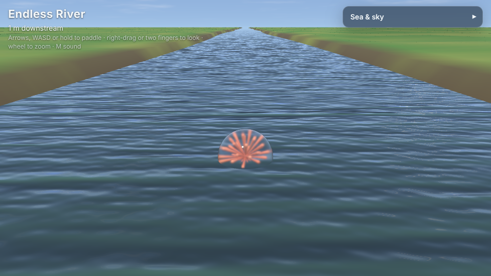
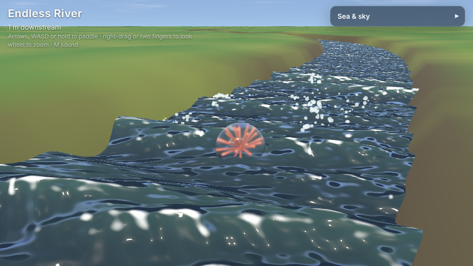

# Endless River

| A calm canal | White rapids |
|---|---|
|  |  |

A glass float carried down a river that never ends, from a still, straight
canal to narrow, twisting white rapids. Paddle it about, ride the current,
bounce off the banks, and turn the river and the sky with the sliders.

It is built on [madness-engine](https://github.com/h1ddenpr0cess20/madness-engine):
the water and the sky are `madness-engine/ocean`, and the river (its
current, its bends, its banks and how wild its water is) is
`madness-engine/river`, which any game on the engine can use.

## Run

```sh
npm install
npm run dev      # http://localhost:5173
npm run build    # static build in dist/
```

Needs WebGPU or WebGL 2 (any current browser); `?renderer=webgl` or
`?renderer=webgpu` pins one. `?river=rapids&sky=dusk` starts on any of the
rivers (canal, stream, river, rapids) under any of the skies (dawn, noon,
dusk, storm, night); `?panel=closed` starts with the panel folded.

## Controls

- Arrows, WASD or hold to paddle
- Right-drag or two fingers to look, wheel to zoom
- M for sound

## The sliders

- **River**: canal ↔ rapids, which sets everything below at once; then the
  current, the width, how much it winds and how murky the water is
- **Sky**: time of day, overcast, clouds, haze, exposure, and letting the day go by
- **View**: camera distance

## How the river works

- The water is the ocean's, made a river's: short ripples running down the
  stream, and the whole surface carried along by the current (each wave's
  phase moves on by the current along it, as well as by its own speed).
- The current is fastest down the middle and slower by the banks; it
  carries the float along with it.
- Wilder rivers are narrower, wind more, run faster, and their water is
  higher, steeper and whiter, with spray thrown up.
- The banks are laid again round the float as it goes, out to the horizon.

## Layout

- `src/main.js`: the stage, the river, the float, the camera and the loop
- `src/float.js`: the float on the water
- `src/panel.js`: the sliders
- `src/sound.js`: the water's sound
